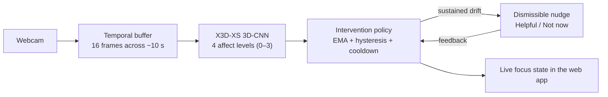

# FrontalOS

**Real-time engagement estimation from webcam video, built as the focus-support engine of an ADHD-oriented platform.**

Graduation Project, Professional Diploma (2026). **v2 in progress.**

[](https://github.com/aml-wajeh/FrontalOS/actions/workflows/ci.yml)
[](https://github.com/aml-wajeh/FrontalOS/actions/workflows/codeql.yml)

> **Research prototype. Not a diagnostic or medical device.** It estimates visible engagement cues; it does not detect, diagnose or treat ADHD.

---

## What it does



1. Frames are buffered on the machine, and **16 frames are sampled across the last ~10 seconds**. This is the same way the training clips were built.
2. A fine-tuned **X3D-XS** video model scores engagement, boredom, confusion and frustration about once a second.
3. A **deterministic policy** turns these noisy scores into a calm focus state. It nudges only after sustained low engagement, and it backs off when the user dismisses a nudge.
4. Frames are processed in memory and never stored. Only scores leave the inference engine.

## v1 → v2: what changed, and why

An honest held-out evaluation of v1 showed that the original model had **learned nothing from the video**. The cause was a defect in the architecture:

| Defect found in v1 | Effect | v2 fix |
|---|---|---|
| pytorchvideo's X3D head ends in `Softmax(dim=1)`, which was kept | The 4 "regression" outputs were forced to sum to 1, so they could never reach DAiSEE's 0–3 levels. The model output engagement ≈ 1.0 for every clip. | Removed the activation. |
| Inputs were not normalized with the Kinetics mean/std that the backbone was pretrained on | Mismatch with the pretrained features | Normalization now happens inside the model, so training, evaluation and serving can't disagree. |
| Live inference used the last 16 *consecutive* frames (~0.5 s) | **Train/serve skew**: the model was trained on ~10 s clips | `TemporalFrameBuffer` samples across a ~10 s window. |
| The Test split was never evaluated, and there was no baseline | No evidence the model worked | `evaluate.py` scores the Test split against baselines, with bootstrap CIs. |
| Every frame's score was shown directly | Noisy and distracting | `InterventionPolicy`: EMA smoothing, hysteresis, a sustain time, and cooldown with back-off. |

## Results: DAiSEE held-out Test split (1,784 clips)

Labels are ordinal levels 0–3. **QWK** (quadratic weighted kappa) measures agreement beyond chance. A constant predictor always scores 0.

| Label | v1 QWK | **v2 QWK (95% CI)** | v2 macro-F1 | Best baseline macro-F1 | v2 MAE | Mean-baseline MAE |
|---|---|---|---|---|---|---|
| Engagement | 0.000 | **0.104** (0.063–0.143) | 0.250 | 0.165 | 0.525 | 0.544 |
| Boredom | 0.001 | **0.085** (0.052–0.119) | 0.188 | 0.158 | 0.720 | 0.710 |
| Confusion | 0.000 | **0.231** (0.187–0.272) | 0.281 | 0.201 | 0.545 | 0.576 |
| Frustration | 0.000 | **0.077** (0.040–0.116) | 0.246 | 0.219 | 0.394 | 0.430 |

| | v1 | v2 | Always predict the train mean |
|---|---|---|---|
| Overall MSE (4 labels) | 1.180 | **0.463** | 0.462 |
| Best validation MSE during training | 1.368 | **0.592** | n/a |

**How to read this:**

- **v2 learns a real but weak signal.** QWK is above zero on all four labels, with confidence intervals that exclude zero, and macro-F1 beats both baselines on every label. v1 was indistinguishable from a constant predictor.
- **On squared error, v2 only matches the mean baseline.** DAiSEE is heavily imbalanced (95% of test clips have engagement level 2 or 3), so predicting the average is a strong baseline for MSE. The gains show up in ranking and ordinal agreement, not in raw error.
- **Confusion is the strongest label** (QWK 0.23). Boredom and frustration are close to the noise floor.
- **This is not good enough for decisions about a person.** It is enough to drive a gentle, dismissible nudge after sustained low engagement, which is the only way the system uses it.

Reproduce the results:

```bash
cd FrontalOS_Engine
python evaluate.py --tag v2
python evaluate.py --tag v1 --legacy-v1 --weights frontal_x3d_model.pth
```

Full tables are in [`TEST_RESULTS_v2.md`](FrontalOS_Engine/results/TEST_RESULTS_v2.md) and [`TEST_RESULTS_v1.md`](FrontalOS_Engine/results/TEST_RESULTS_v1.md). Per-epoch training history is in [`train_history_v2.json`](FrontalOS_Engine/results/train_history_v2.json).

### Latency

Measured with `bench_latency.py`: one 16×224×224 window, after warm-up.

| Device | p50 | p95 |
|---|---|---|
| NVIDIA Quadro P2000 (4 GB), fp16 autocast | 64 ms | 74 ms |
| Intel CPU, 6 threads, fp32 | 470 ms | 505 ms |

The engine scores one window per second, so it runs in real time **even without a GPU**. The model has 2.98 M parameters.

### Training setup

| Item | Setup |
|---|---|
| Model | X3D-XS, Kinetics-400 pretrained |
| Data | DAiSEE official splits: 5,357 train clips and 1,429 validation clips |
| Optimisation | MSE loss, AdamW at 1e-4 with ReduceLROnPlateau |
| Batch and hardware | AMP, gradient accumulation to an effective batch of 16, on a 4 GB GPU |
| Stopping | Seed 42; early stopping after 6 epochs (best at epoch 2) |

## Repository layout

| Folder | Contents |
|---|---|
| [`FrontalOS_Engine/`](FrontalOS_Engine) | Model code: training, held-out evaluation, metrics, latency benchmark, the live webcam observer, and the weights (v1 and v2). |
| [`frontalos-platform/`](frontalos-platform) | Platform monorepo, listed below. |

The platform monorepo contains:

- **Next.js 14 + TypeScript** web app with role-based portals
- **FastAPI** backend on **PostgreSQL** + Redis
- **FastAPI WebSocket** real-time engine
- **Docker Compose** with 6 services behind **Nginx**

## Run it

```bash
cd frontalos-platform
cp .env.example .env    # set JWT_SECRET_KEY
docker compose up --build
```

Then open http://localhost:3000.

To run the stand-alone webcam observer:

```bash
cd FrontalOS_Engine
python live_observer.py
```

## Engineering

- **CI** runs on every push: lint and tests for the ML code, the real-time engine, the backend and the web app, plus Docker image builds.
- **Security**:
  - CodeQL static analysis
  - Secret scanning with push protection
  - Dependabot
  - Protected `main` branch
  - See [SECURITY.md](SECURITY.md)
- **Data**: DAiSEE is **not included** because of its size and license. Get it from its official source, then set `DAISEE_ROOT`.

## Limitations

- DAiSEE shows students in a specific recording setup. Performance on other people, cameras and lighting is untested.
- Engagement as labelled by annotators is not the same as attention, and neither one is ADHD.
- About 400 train and validation clips have no matching row in the official label CSVs, and the loader skips them.
- The policy thresholds are product defaults. They have not been validated against any real outcome.

## Roadmap

- MediaPipe landmark baseline (head pose and gaze) vs. X3D: is a 3D CNN needed at all?
- Ordinal or class-balanced loss to fight label imbalance
- ONNX export and in-browser inference, so frames never leave the browser
- Upgrade dependencies flagged by Dependabot

## License

All rights reserved. The code is viewable for portfolio and evaluation purposes only. See [LICENSE](LICENSE).
