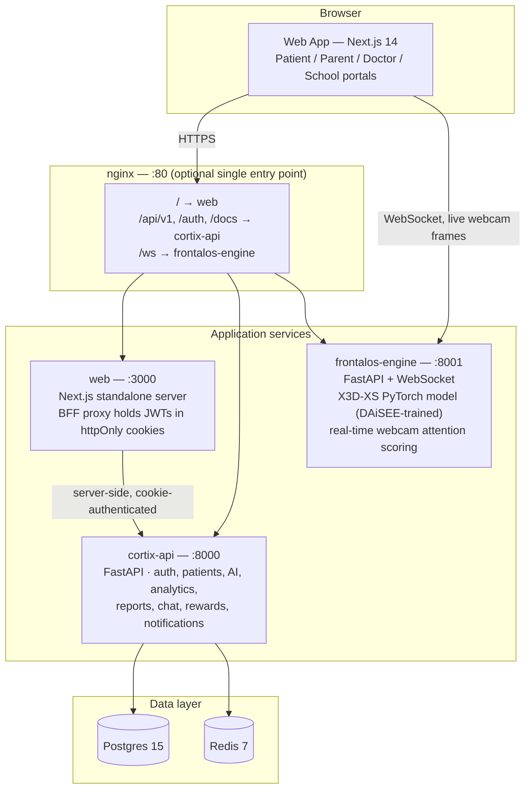

# FrontalOS Platform

**NeuroSync / Synapsa** — an ADHD digital therapeutics platform: real-time
webcam-based attention/engagement detection, AI-assisted clinical decision
support (tabular + MRI models), and four purpose-built portals (Patient,
Parent, Doctor, School) sharing one auth system and one design system.

Every AI endpoint is honest about its own confidence: responses are
explicitly tagged `inference_mode: "live"` or `"demo"` depending on whether
real trained weights are present, so nothing pretends to be a clinical
result when it isn't. See `docs/AUDIT.md` for the full documentation-vs-code
audit this backend was rebuilt against, and
`services/cortix-api/docs/MODELS_README.md` for exactly how to switch from
demo to live mode.

**Get it running in one command:** see **[docs/RUNBOOK.md](docs/RUNBOOK.md)**.
Short version:
```bash
cp .env.example .env   # set JWT_SECRET_KEY
docker compose up --build
```
Then open http://localhost:3000 and log in with one of the demo accounts
listed in the runbook.

---

## Architecture



- **`apps/web`** — Next.js 14 App Router. All four portals live here
  behind route groups (`(patient)`, `(parent)`, `(doctor)`, `(school)`),
  plus `(auth)` for login/register/password reset. A same-origin BFF proxy
  route (`app/api/proxy/[...path]`) is the only place that ever attaches a
  bearer token to outbound API calls — the browser never sees raw JWTs.
- **`services/cortix-api`** — FastAPI backend: real Postgres-backed auth
  (bcrypt + JWT access/refresh), patients/appointments/messages,
  AI inference endpoints (tabular XGBoost + imaging CNN, each independently
  live/demo), analytics, PDF report generation, a templated chat endpoint,
  and a persisted reward-wallet ledger.
- **`services/frontalos-engine`** — a separate, real PyTorch service
  wrapping a trained X3D-XS model (Boredom/Engagement/Confusion/Frustration
  regression, DAiSEE dataset) behind a WebSocket, so the Patient Portal can
  stream webcam frames in and get live attention scores back.
- **`packages/design-tokens`** — the single source of truth for brand
  color (parsed from `brand_color_palette.md`), consumed by `apps/web` via
  Tailwind and CSS variables.

## Links

- **[docs/RUNBOOK.md](docs/RUNBOOK.md)** — prerequisites, first run,
  verification, live-AI-mode switch, running without Docker, troubleshooting.
- **[docs/AUDIT.md](docs/AUDIT.md)** — the documentation-vs-code audit that
  `services/cortix-api` was rebuilt against (what was mocked, what's real
  now, file:line references).
- **[services/cortix-api/docs/MODELS_README.md](services/cortix-api/docs/MODELS_README.md)**
  — where trained model weight files go, and how demo vs. live mode is
  decided per-endpoint.

> Note: earlier revisions of this README linked a `REMAINING_STEPS.md`
> file that was never actually added to the repo — that link has been
> removed rather than left dangling. `docs/AUDIT.md` is this project's one
> source of truth for what's done vs. still open; genuinely open items
> (Alembic migrations, end-to-end test coverage) are called out inline
> there and in this README's own sections rather than in a second file.

## Folder structure

```
frontalos-platform/
├── apps/
│   ├── web/                        Next.js 14 + TypeScript + Tailwind.
│   │   ├── Dockerfile               Multi-stage: deps → build → standalone run.
│   │   └── src/
│   │       ├── app/                 App Router: (auth) (patient) (parent)
│   │       │                        (doctor) (school) route groups + api/
│   │       │                        (auth routes, BFF proxy) + extension-
│   │       │                        connect/ + api/extension/token/ (the
│   │       │                        browser extension's Connect flow).
│   │       ├── components/          Portal UI, grouped by portal + shared ui/.
│   │       └── lib/                 api clients, auth (cookies/JWT), rewards,
│   │                                websocket hook, validation schemas.
│   └── extension/                   Manifest V3 companion extension (Vite + React).
│       ├── public/manifest.json     Minimal permissions; host permission
│       │                            scoped to the CORTIX API domain only.
│       └── src/
│           ├── popup/                Coin balance + mini Dopamine Menu.
│           ├── background.ts         Connect-flow listener + gentle
│           │                         notification polling (chrome.alarms).
│           └── lib/                  Direct CORTIX API client (bearer
│                                      token, not the web app's cookie proxy).
├── services/
│   ├── cortix-api/                  FastAPI backend.
│   │   ├── Dockerfile               dev (--reload) / prod (gunicorn) targets.
│   │   ├── entrypoint.sh            Bootstrap schema, seed demo data, exec CMD.
│   │   ├── db/seed.py               Idempotent demo accounts + demo patient.
│   │   ├── auth/, api/v1/, core/,
│   │   │   database/                Auth, REST routers, AI services, ORM models.
│   │   ├── docs/MODELS_README.md    Where real model weights go.
│   │   └── reference/CORTIX/        Original pre-integration copy (read-only).
│   └── frontalos-engine/            Real trained PyTorch model as a WS service.
│       ├── Dockerfile
│       ├── models/                  frontal_x3d_model.pth (ships in the repo).
│       └── reference/FrontalOS/     Original pre-integration copy (read-only).
├── packages/
│   └── design-tokens/                Brand color source of truth (tokens.json/
│                                      tailwind.tokens.js/tokens.css).
├── infra/
│   ├── docker/nginx.conf             Single entry point reverse proxy (:80).
│   └── ci/github-actions.yml         Copy of .github/workflows/ci.yml (see its
│                                      own README for why both exist).
├── .github/workflows/ci.yml          The workflow GitHub actually runs.
├── datasets/                         Placeholder — no data checked in; see its
│                                      README for provenance notes (DAiSEE, WiDS).
├── docs/
│   ├── AUDIT.md                      Documentation-vs-code audit (see above).
│   └── RUNBOOK.md                    How to run this, step by step.
├── .env.example                      Every environment variable any service
│                                      in this repo consumes.
├── docker-compose.yml                web, cortix-api, frontalos-engine,
│                                      postgres, redis, nginx — fully wired.
└── package.json                      npm workspaces root ("apps/*", "packages/*").
```
